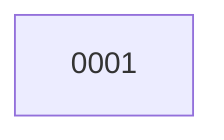

# Backlog

**1 changes** — 🔵 1 built

## 🔵 Built (1)

| # | Title | Priority | Type | PR | State |
|---|-------|----------|------|----|-------|
| [0001](active/0001-correct-v0-1-contract-consistency.md) | Correct v0.1 authority and event contract consistency | `high` | `fix` | [#1](https://github.com/ethanhinson/adp/pull/1) | awaiting merge |

